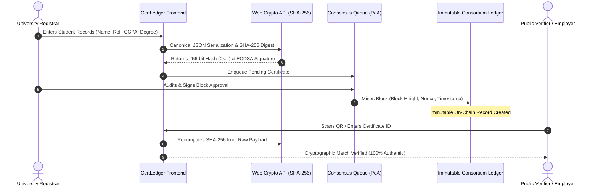

# CertLedger: Blockchain-Based Academic Certificate Verification System

<div align="center">

  

  <h3>Decentralized Higher Education Credential Issuance & Verification Platform</h3>

  <p>
    An enterprise-grade, zero-gas academic verification system powered by deterministic SHA-256 cryptographic digests, Proof-of-Authority (PoA) consortium blockchain simulation, and an authentic dual-mode credential viewer.
  </p>

  <p>
    <a href="https://husenmajibullah322-ba.github.io/blockchain-academic-certificate-verification/"><strong>Explore Live Demo »</strong></a>
  </p>

  <p>
    
    
    
    
    
    
  </p>
</div>

---

## 📑 Table of Contents

- [Overview & Problem Statement](#-overview--problem-statement)
- [Key Features](#-key-features)
- [System Architecture & Cryptography](#-system-architecture--cryptography)
- [Interactive Testing Scenarios](#-interactive-testing-scenarios)
- [Project Structure](#-project-structure)
- [Technology Stack](#-technology-stack)
- [Getting Started](#-getting-started)
- [CI/CD & Deployment](#-cicd--deployment)
- [Security & Privacy](#-security--privacy)
- [License](#-license)

---

## 💡 Overview & Problem Statement

### The Problem
Traditional higher education diplomas and certificates suffer from significant real-world vulnerabilities:
1. **Rampant Credential Forgery**: PDF diplomas, scanned certificates, and printed transcripts are trivially manipulated using standard image editing tools.
2. **Slow Verification Bottlenecks**: Background verification companies, embassies, and employers wait weeks for registrar offices to manually cross-reference paper archives.
3. **Crypto Barriers**: Most public blockchain solutions require end-users, students, and HR departments to hold cryptocurrencies, configure Web3 browser extensions (like MetaMask), and pay volatile gas fees.

### The Solution: CertLedger
**CertLedger** provides a frictionless, zero-trust credential verification network for academic institutions:
- **Zero Gas & No Crypto Wallets Needed**: Anyone can verify a degree in seconds by scanning a QR code or entering a student ID or hash.
- **Deterministic Cryptographic Proofs**: Degree data is canonicalized into standardized UTF-8 JSON payloads and digested into immutable SHA-256 fingerprints using the browser's native **Web Crypto API** (`crypto.subtle`).
- **Proof-of-Authority (PoA) Consortium**: Only verified registrar nodes (e.g. *Integral University, Lucknow*) have authority to sign and propose credential blocks.
- **Dual Credential Rendering**: Features both a high-resolution, printable academic parchment with gold verification stamp and registrar signature, as well as an Apple/Google Wallet-inspired mobile credential pass.

---

## 🌟 Key Features

### 1. Instant Ledger Audit Terminal
- Live search bar supporting:
  - **Certificate ID** (e.g. `CERT-IU-2026-1001` or `PGDIT12345`)
  - **Student Roll Number** (e.g. `IU-2022-BCS-8901`)
  - **64-Character SHA-256 Hash** (`0x...`)
- Real-time cryptographic recalculation to confirm whether the document's stored hash matches the ledger hash.
- Built-in **Simulate Tampered Document** button demonstrating the cryptographic **avalanche effect** (modifying 1 character invalidates the whole digest).

### 2. Official Dual-Mode Certificate Modal
- **Official Printed Parchment Format**:
  - High-resolution classic diploma typography (`Cinzel` serif & `Caveat` handwriting signatures).
  - Authentic gold radial-embossed seal.
  - Institutional crest and registrar signature.
  - Cryptographic strip with dynamic QR matrix code and transaction metadata.
  - Print & PDF export ready (`@media print` clean layout with hidden UI overlays).
- **Mobile Credential Pass Format**:
  - Clean smartphone-native layout for quick mobile verification and credential sharing.

### 3. Registrar Issuance Suite
- Multi-field student enrollment form (student name, roll number, course, department, CGPA, graduation date, honors).
- Automatic deterministic payload generation.
- Real-time **Cryptographic Proof Preview** showing the raw UTF-8 canonical JSON string, computed SHA-256 hash, and generated digital signature.
- Instant routing to the **Consensus Validation Queue**.

### 4. Consensus Queue & Block Mining
- Multi-signature queue where incoming certificates wait for institutional validator approval.
- Full payload inspection drawer to verify raw JSON before block anchoring.
- One-click **Approve & Mine Block** action that computes block headers, assigns block heights (`#148200+`), calculates nonces, and updates the synchronized ledger state.

### 5. Institutional Validator Node Portal
- Node health telemetry (online status, active signers, block height ticker).
- Specification overview: **ERC-721 Soulbound Token (SBT)** non-transferable credential standard.
- Pre-configured demo administrator authentication (`admin@integral.edu.in` / `admin123`) and node onboarding workflow.

### 6. Sleek shadcn/ui (Zinc) Design System
- Built with a modern **shadcn/ui Zinc** aesthetic: matte black surfaces (`#09090b`), elevated card frames (`#0e0e11`), subtle borders (`#27272a`), and high-contrast typography.
- Smooth light and dark mode toggle persisted in local storage.
- Fully responsive collapsible sidebar and mobile slide-out drawer.

---

## 🏛️ System Architecture & Cryptography



### Cryptographic Workflow Breakdown

1. **Deterministic UTF-8 Canonicalization**:
   ```javascript
   function createCertificatePayload(data) {
     return JSON.stringify({
       id: data.id,
       studentName: data.studentName.trim(),
       studentId: data.studentId.trim().toUpperCase(),
       course: data.course.trim(),
       department: data.department.trim(),
       institution: data.institution.trim(),
       issueDate: data.issueDate,
       passingYear: data.passingYear,
       cgpa: data.cgpa
     });
   }
   ```
2. **SHA-256 Digest Computation**:
   ```javascript
   const msgUint8 = new TextEncoder().encode(canonicalPayload);
   const hashBuffer = await window.crypto.subtle.digest('SHA-256', msgUint8);
   const hashArray = Array.from(new Uint8Array(hashBuffer));
   const hashHex = hashArray.map(b => b.toString(16).padStart(2, '0')).join('');
   ```
3. **Avalanche Effect & Tamper Detection**:
   If even a single letter, number, or space in the student's name or CGPA is modified, the resulting 256-bit hexadecimal string differs completely, causing an immediate verification failure.

---

## 🧪 Interactive Testing Scenarios

You can test the entire lifecycle directly in the web app:

| Test Target | Query to Enter | Expected Result |
| :--- | :--- | :--- |
| **Diploma Sample** | `PGDIT12345` | Instant **VERIFIED** card for Kyle Henderson with 1-click button to view the official gold-seal parchment diploma. |
| **Undergraduate Sample** | `IU-2022-BCS-8901` | **VERIFIED** record for Mohd. Zaid Khan (B.Tech Computer Science, 9.45 CGPA). |
| **Postgraduate Sample** | `IU-2022-MCA-4412` | **VERIFIED** record for Ayesha Siddiqui (MCA Cloud Computing, 9.80 CGPA). |
| **Simulated Forgery** | Click *"Simulate Tampered Document"* | Immediate **TAMPER DETECTED** banner showing hash mismatch and integrity failure. |
| **Registrar Sign In** | Click *"Admin Sign In"* | Click *"Autofill Demo Admin Credentials"* (`admin@integral.edu.in`) to access node signing controls. |

---

## 📁 Project Structure

```
.
├── .github/
│   └── workflows/
│       └── deploy.yml            # Automated GitHub Pages CI/CD workflow
├── public/
│   ├── favicon.svg               # Application browser icon
│   ├── icons.svg                 # SVG sprite sheet
│   └── integral_university_logo.jpg  # Institutional crest asset
├── src/
│   ├── assets/                   # Static media resources
│   ├── components/
│   │   ├── AddCertificateSection.jsx   # Registrar data entry & SHA-256 generator
│   │   ├── AdminSection.jsx            # Validator node telemetry & contract specs
│   │   ├── AuthModal.jsx               # Institutional admin login & node registration
│   │   ├── CertificateModal.jsx        # Dual-mode parchment & mobile pass modal
│   │   ├── ContactSection.jsx          # Consortium inquiry portal & FAQs
│   │   ├── Header.jsx                  # Top navigation bar with block ticker
│   │   ├── HomeSection.jsx             # Hero verifier, telemetry & protocol steps
│   │   ├── PendingSection.jsx          # PoA consensus pool & block mining trigger
│   │   ├── Sidebar.jsx                 # Collapsible side navigation & theme toggle
│   │   └── VerifiedSection.jsx         # Public ledger explorer & live hash audit
│   ├── data/
│   │   └── mockData.js                 # Initial verified records & storage synchronization
│   ├── utils/
│   │   └── cryptoUtils.js              # Native Web Crypto SHA-256 & block generator
│   ├── App.jsx                         # Main application state orchestrator
│   ├── index.css                       # shadcn/ui Zinc design system stylesheet
│   └── main.jsx                        # React root entrypoint
├── index.html                          # HTML shell with responsive viewport tags
├── package.json                        # Project metadata and dependencies
├── vite.config.js                      # Vite bundling configuration with relative base
└── README.md                           # Documentation & architecture guide
```

---

## 🛠️ Technology Stack

| Layer | Technology | Details |
| :--- | :--- | :--- |
| **Frontend Framework** | **React 19** (`19.2.8`) | Modern component-based architecture with hooks |
| **Build & Tooling** | **Vite 8** (`8.3.4`) | Ultra-fast HMR and optimized production bundling |
| **Styling & Theme** | **CSS3 Design Tokens** | Custom **shadcn/ui Zinc** dark/light palette with pure CSS variables |
| **Cryptography** | **W3C Web Crypto API** | Native in-browser SHA-256 cryptographic digest computation |
| **Icons** | **Lucide React** (`^1.55.0`) | Modern, consistent SVG iconography |
| **Typography** | **Google Fonts** | `Inter` (UI), `JetBrains Mono` (hashes), `Cinzel` (diploma), `Caveat` (signatures) |
| **State Persistence** | **Browser LocalStorage** | Synchronized client-side state for offline testing |
| **CI/CD & Hosting** | **GitHub Actions + Pages** | Zero-config continuous deployment on push to `main` |

---

## 🚀 Getting Started

### Prerequisites
- **Node.js**: v18.0.0 or higher
- **npm**: v9.0.0 or higher (or pnpm / yarn)

### Installation

1. **Clone the repository**:
   ```bash
   git clone https://github.com/husenmajibullah322-ba/blockchain-academic-certificate-verification.git
   cd blockchain-academic-certificate-verification
   ```

2. **Install project dependencies**:
   ```bash
   npm install
   ```

3. **Start the local development server**:
   ```bash
   npm run dev
   ```
   Open [http://localhost:5173](http://localhost:5173) in your browser.

4. **Build for production**:
   ```bash
   npm run build
   ```
   The production-ready artifacts will be generated in the `dist/` directory.

5. **Preview production build locally**:
   ```bash
   npm run preview
   ```

---

## 🔄 CI/CD & Deployment

The repository includes a GitHub Actions workflow (`.github/workflows/deploy.yml`) that automatically builds and publishes the application to **GitHub Pages** whenever changes are pushed to `main`:

```yaml
name: Deploy to GitHub Pages
on:
  push:
    branches: ["main"]
jobs:
  build-and-deploy:
    runs-on: ubuntu-latest
    steps:
      - uses: actions/checkout@v4
      - uses: actions/setup-node@v4
        with:
          node-version: 20
      - run: npm ci
      - run: npm run build
      - uses: actions/upload-pages-artifact@v3
        with:
          path: './dist'
      - uses: actions/deploy-pages@v4
```

---

## 🔒 Security & Privacy

- **Soulbound Tokens (SBT)**: Academic credentials are modeled after ERC-721 Soulbound Tokens—they are bound to the student recipient and non-transferable.
- **Client-Side Verification**: Cryptographic hashing occurs directly inside the user's browser using `window.crypto.subtle`. Sensitive student credentials do not need to be transmitted to third-party verification servers.
- **Data Integrity**: Any unauthorized alteration in student details, grades, or conferral dates generates a completely mismatched SHA-256 fingerprint, guaranteeing instant detection.
- **High-Resolution Print Protection**: Print stylesheets ensure that only the official parchment document prints cleanly without web navigation or UI controls.

---

## 📄 License

This project is licensed under the **MIT License**. Feel free to use, modify, and distribute it for academic and institutional verification research.

---

<div align="center">
  <sub>Built with ❤️ for academic credential integrity • Integral University Academic Consortium</sub>
</div>
